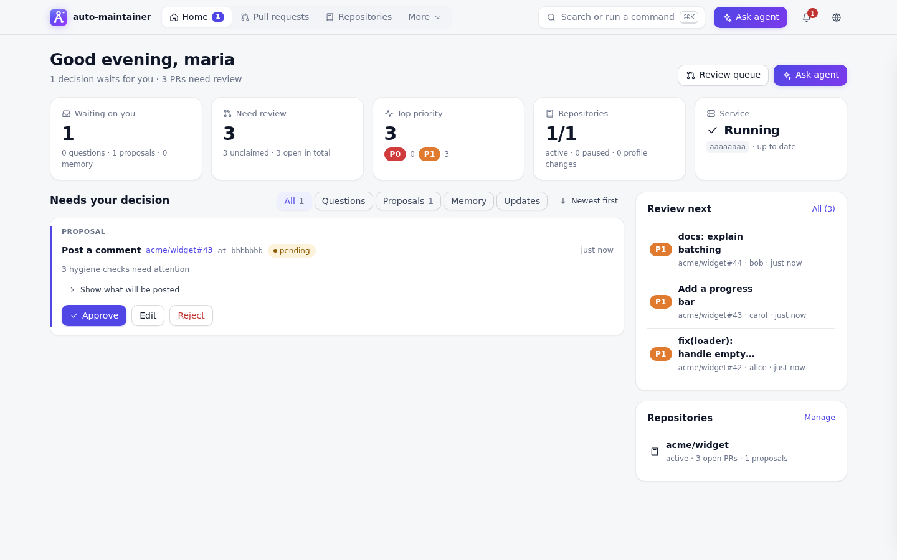
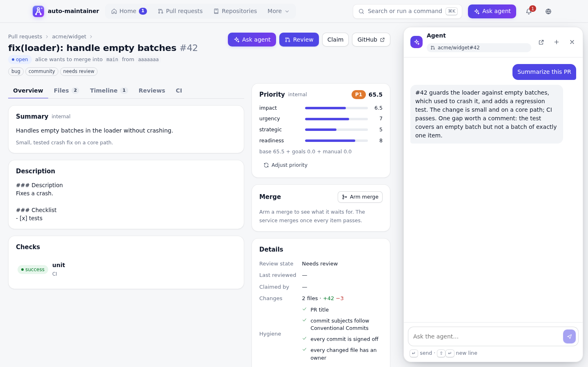
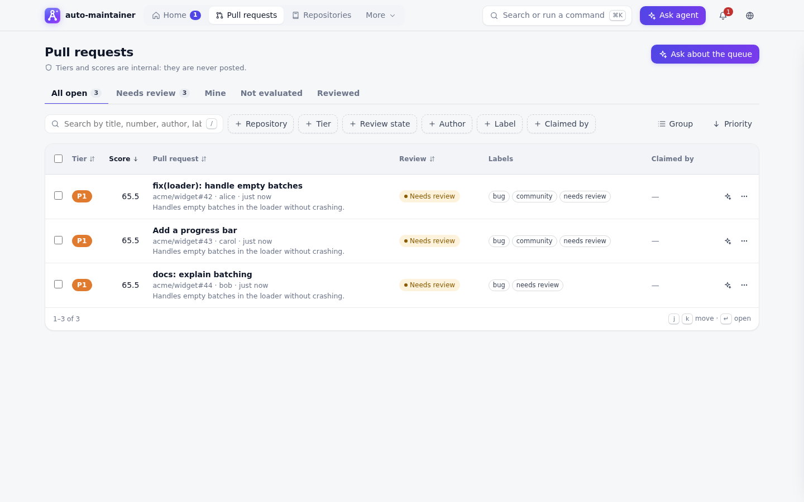
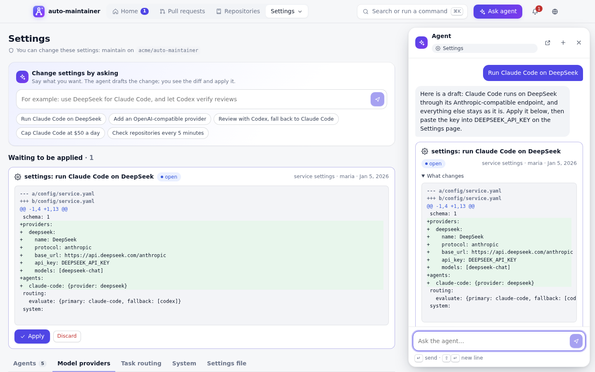
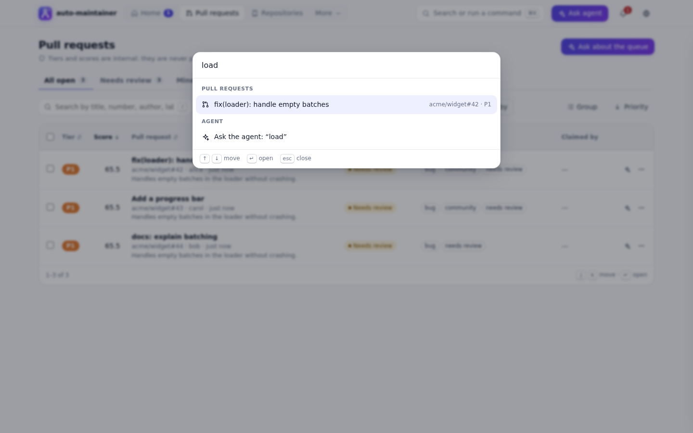
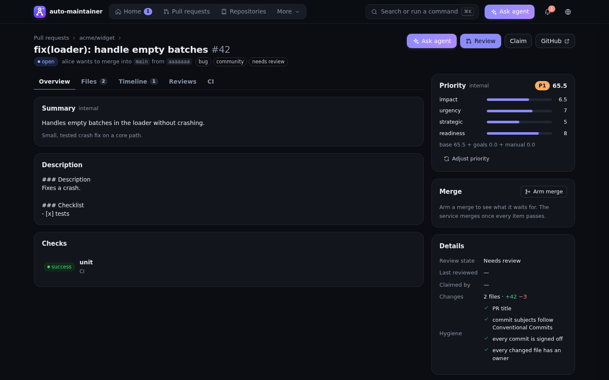

<p align="center">
  
</p>

<h1 align="center">auto-maintainer</h1>

<p align="center">
  An AI maintainer for GitHub repositories. It triages, ranks, and reviews pull requests,
  explains failed CI, reruns flaky jobs, and merges what is ready, using the coding agents
  installed on its host. Nothing public happens until a maintainer allows it.
</p>

<p align="center">
  
  
  
  
</p>

<p align="center">
  <a href="#try-it-in-two-minutes">Try it</a> ·
  <a href="#run-it-on-your-repositories">Run it</a> ·
  <a href="#configure-it">Configure it</a> ·
  <a href="#supported-agents">Agents</a> ·
  <a href="#how-it-works">How it works</a> ·
  <a href="docs/design.md">Design</a>
</p>



## What it does

- **Reviews pull requests.** Agents draft the review, a second agent verifies the findings, and the draft waits for a maintainer to edit and post it. Follow-ups after new commits check what was fixed.
- **Ranks the queue.** Every open PR gets an internal priority from a rubric your maintainers own. Scores never appear on GitHub. Overrides teach the rubric.
- **Keeps CI moving.** Failed jobs are diagnosed as flaky, infrastructure, or caused by the PR; flaky ones are rerun.
- **Merges what is ready.** A maintainer arms a merge; the service merges once every check, approval, and rule in the repository's profile passes.
- **Checks conventions.** PR titles, commit messages, sign-offs, templates, CODEOWNERS coverage, license headers, or any check the repository adds.
- **Learns and remembers.** Lessons from maintainers' edits and overrides go to a private memory repository on GitHub, as reviewable changes.
- **Improves itself.** Ask for a feature in a conversation; the service changes its own code, runs the tests, and opens a PR that a maintainer of its repository merges and deploys.

It adapts to each repository through a profile its maintainers approve, and it starts in **shadow** mode: it records what it would do and posts nothing until you raise an action to `propose` or `auto`.

## A look at the dashboard

**The agent on every page.** Press <kbd>Ctrl</kbd>/<kbd>⌘</kbd>+<kbd>J</kbd> on any page and ask about what is on it. It sees what you can see; anything it suggests changing waits for your approval.



**Every list sorts, filters, and groups.** Saved views, filters by any facet, sorting by any column, grouping, bulk actions, and keyboard navigation (<kbd>j</kbd> <kbd>k</kbd> <kbd>Enter</kbd> <kbd>x</kbd> <kbd>/</kbd>). The view lives in the URL, so you can share it.



**Settings by asking.** Say what should change ("run Claude Code on DeepSeek"). The agent drafts the edit, you see the diff, and a maintainer applies it. API keys go only into their own fields and stay on the host.



<table>
  <tr>
    <td width="50%"><br><b>Go anywhere.</b> <kbd>Ctrl</kbd>/<kbd>⌘</kbd>+<kbd>K</kbd> finds pages, repositories, and PRs, runs commands, or hands your text to the agent.</td>
    <td width="50%"><br><b>Light or dark.</b> It follows your system, or pick one; English and 中文.</td>
  </tr>
</table>

## Try it in two minutes

The demo runs the whole service on fakes with sample data. Nothing leaves your machine.

```bash
git clone https://github.com/RLinf/auto-maintainer.git
cd auto-maintainer
uv sync
uv run am serve --demo
```

Open <http://127.0.0.1:7777/auth/dev?login=maria> to sign in as a sample maintainer. The first start builds the dashboard, which needs Node 20 or newer.

## Run it on your repositories

### 1. What you need

- Python 3.11+ with [uv](https://docs.astral.sh/uv/), Node 20+, and git.
- At least one agent CLI, signed in: [Claude Code](https://docs.anthropic.com/en/docs/claude-code), [Codex](https://github.com/openai/codex), [OpenCode](https://opencode.ai), [Gemini CLI](https://github.com/google-gemini/gemini-cli), or Antigravity.
- A GitHub identity for the service: a GitHub App (recommended) or a token, plus an OAuth app for dashboard sign-in. Its callback URL is `<base_url>/auth/callback`.
- A private repository for the service's memory, such as `your-org/auto-maintainer-memory`.

### 2. Configure the host

```bash
uv run am init            # writes ~/.config/auto-maintainer/local.yaml and secrets.env
```

Edit `~/.config/auto-maintainer/local.yaml`:

```yaml
port: 7777
host: 0.0.0.0                           # listen on every interface
base_url: http://your-host:7777         # what browsers open; GitHub sign-in calls back here
operators: [your-login]
github:
  auth: token                           # or app, with app_id and private_key_path
  token_env: GITHUB_TOKEN
  oauth_client_id: Iv1.xxxxx
memory:
  remote: your-org/auto-maintainer-memory
code_repo: your-org/auto-maintainer     # the service's own code; its maintainers own the service settings
```

Put the secrets in `~/.config/auto-maintainer/secrets.env` (mode 600):

```bash
GITHUB_TOKEN=...
AM_OAUTH_CLIENT_SECRET=...
```

### 3. Check and start

```bash
uv run am doctor --live   # forge access, memory repo, and a tiny task on each agent CLI
uv run am supervise       # serves on :7777, restarts after deploys, rolls back a bad one
```

`am supervise` runs `am serve` and keeps it running. Use `am serve` directly when you develop. Press <kbd>Ctrl</kbd>+<kbd>C</kbd> once to stop either.

To try it against GitHub without touching real repositories, run `uv run am serve --dev`. It holds every repository action in shadow, or acts only on `sandbox_repo` when you set one in `local.yaml`.

### 4. Add a repository

On the dashboard, open **Repositories → Add repository**, or run `uv run am repo add your-org/your-repo`. An agent reads the repository and drafts its profile; a maintainer of that repository approves it. From then on the service works in shadow. Raise actions to `propose` (you approve each one) or `auto` when the agreement scores on the repository page say it is ready.

## Configure it

There are three kinds of configuration, and each belongs to the people it affects:

| What | Where | Who changes it |
|---|---|---|
| **Service settings**: which agents run, model providers and their keys, budgets, the default agent per task, polling and write limits | **Settings** page, by asking the agent or editing `config/service.yaml` | Maintainers of the service's repository (`code_repo`) |
| **Repository profile**: scope, labels, checks, review template, rubric, merge rules, autonomy per action, routing | Each repository's page, by asking the agent or editing its settings layer; public conventions can live in `.github/auto-maintainer.yml` in the repository | Maintainers of that repository |
| **Host**: port, data directory, GitHub credentials, lab hosts, operators | `local.yaml` and `secrets.env` | Whoever runs the host |

Every change is checked against the user's GitHub permission at the moment it is made (`maintain` by default). Others can propose a change, and it waits for a maintainer. The service can never approve its own changes. Each change is a commit in the memory repository, so there is a history and a diff.

**Custom model providers.** Any agent that supports it can use an OpenAI-compatible or Anthropic-compatible endpoint instead of its CLI's own sign-in. Ask on the Settings page ("add an OpenAI-compatible provider at https://… for Codex"), then paste the key into the provider's key field. **Test connection** lists the endpoint's models without spending tokens.

## Supported agents

| Agent CLI | How the service talks to it | Questions reach reviewers | Custom providers |
|---|---|---|---|
| Claude Code | `stream-json` with the CLI's permission prompts | yes | Anthropic-compatible |
| Codex | `codex app-server` (JSON-RPC) | yes | OpenAI-compatible (Chat Completions or Responses) |
| OpenCode | ACP (`opencode acp`) | yes | both |
| Gemini CLI | ACP | yes | no |
| Antigravity | ACP (`agy acp`) | yes | no |
| pi, dsh, others | a command template (generic adapter) | no | both, through environment variables |

Agents run in their CLI's own auto mode. Whatever the CLI would ask a person goes to **Agent questions** on the dashboard (and a toast for whoever is online); an unanswered question is denied when it expires. Agents never receive GitHub write credentials: the service alone writes to GitHub, after policy allows it.

## How it works

```
GitHub ──poll/webhooks──▶ events ──▶ engine ──▶ playbooks ──▶ agents (Claude Code, Codex, …)
                                                     │
                                                     ▼
                                   actions ──▶ policy: shadow │ propose │ auto
                                                     │              │
                                         maintainer approves ◀──────┘
                                                     ▼
                                          actuator ──▶ GitHub, memory repo, labs
```

Playbooks (triage, review, follow-up, priority, CI diagnosis, hygiene, merge, onboarding, …) ask agents for judgment and return actions. They never write. The policy decides, per repository and action kind, whether an action is only recorded, proposed to a maintainer, or executed. Every action has an idempotency key, so retries post once.

Some limits hold whatever the configuration says:

- The service never approves PRs and never pushes to target repositories.
- It posts at most one review per head commit.
- It mentions only the PR's author and CODEOWNERS.
- Internal priorities never reach public text.

The full design is in [docs/design.md](docs/design.md).

## Keyboard shortcuts

| Keys | Does |
|---|---|
| <kbd>Ctrl</kbd>/<kbd>⌘</kbd>+<kbd>K</kbd> | Search, go anywhere, run a command, ask the agent |
| <kbd>Ctrl</kbd>/<kbd>⌘</kbd>+<kbd>J</kbd> | Open or close the agent |
| <kbd>g</kbd> then <kbd>h</kbd> / <kbd>p</kbd> / <kbd>r</kbd> / <kbd>i</kbd> / <kbd>q</kbd> / <kbd>m</kbd> / <kbd>s</kbd> | Home, Pull requests, Repositories, Proposals, Questions, Memory, Settings |
| <kbd>/</kbd> | Search the list on the page |
| <kbd>j</kbd> <kbd>k</kbd> <kbd>Enter</kbd> <kbd>x</kbd> | Move, open, select in a list |
| <kbd>?</kbd> | All shortcuts |

## Development

```bash
uv sync                                     # Python environment with dev tools
uv run pytest                               # unit and flow tests on fakes: no network, no agent CLIs
uv run pytest -m live_agent                 # contract tests against installed CLIs (costs money)
uv run ruff check . && uv run ruff format --check .
uv run am serve --demo --port 7788         # in one terminal: the API the dev server proxies to
cd ui && npm ci && npm run dev              # in another: the dashboard with hot reload on :5173
```

| Path | Holds |
|---|---|
| `src/auto_maintainer/domain/` | Types, pure rules, and ports. No I/O. |
| `src/auto_maintainer/playbooks/` | One module per playbook |
| `src/auto_maintainer/policy/`, `actuator/` | Decisions, and the only code that writes |
| `src/auto_maintainer/agents/` | One adapter per agent CLI, the router, and permission answers |
| `src/auto_maintainer/web/` | The API, sign-in, chat, and settings |
| `ui/` | The dashboard (React, TypeScript, Vite) |
| `config/defaults/`, `packs/`, `skills/` | Default profile, packs, and skills for the agents |

Read [AGENTS.md](AGENTS.md) before you change anything: it lists the rules reviewers enforce (layering, the configuration gate, typed public text, hard limits). Commits follow Conventional Commits with a `Signed-off-by` trailer (`git commit -s`).

## Status

Early. Everything above runs and is tested on fakes. The GitHub reads, sign-in, and every agent CLI except OpenCode and Gemini have been checked live. Not built yet: the MCP server for the chat agent, replay evaluations, issue triage, and the release assistant. See [section 11 of the design](docs/design.md#11-milestones) for the full list.

## License

[Apache-2.0](LICENSE)
